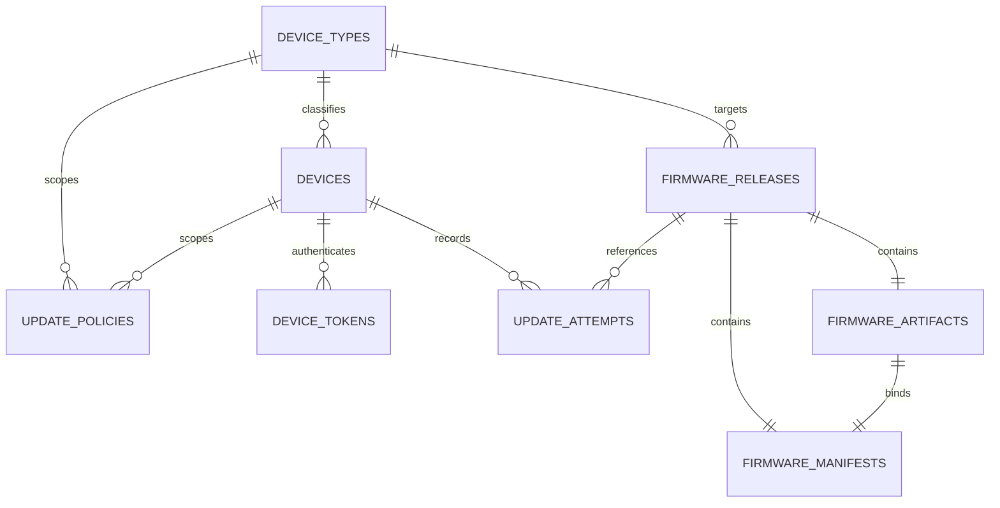

# Database Schema

This document records the PostgreSQL schema represented by `app/db/models.py` and the applied Alembic history. Backend developers, reviewers, operators, and migration authors use it before changing persisted data. It governs tables, relationships, constraints, and data lifecycle; firmware object bytes and application workflows are out of scope.

## Scope

- In scope: tables, columns, foreign keys, uniqueness, indexes, migration order, and storage boundary.
- Out of scope: MinIO object contents and undocumented production data.

## Tables

### `device_types`

Purpose: stable product and platform identity used in OTA paths.

| Column                 | Type         | Nullable | Constraint   |
| ---------------------- | ------------ | -------- | ------------ |
| id                     | bigint       | no       | primary key  |
| code                   | varchar(64)  | no       | unique       |
| name                   | varchar(128) | no       |              |
| platform               | varchar(64)  | no       |              |
| hardware_revision      | varchar(32)  | yes      |              |
| description            | text         | yes      |              |
| is_active              | boolean      | no       | default true |
| created_at, updated_at | timestamptz  | no       | default now  |

### `devices`

Purpose: registered hardware identity and current server-known OTA state.

Key columns are `id`, `device_type_id`, unique `serial_number`, unique `raw_efuse_mac`, nullable `network_mac`, `status`, `ota_enabled`, known-version provenance fields, last-download fields, registration and observation timestamps. Indexes cover device type and status.

### `device_tokens`

Purpose: hashed per-device credentials and their lifecycle.

Key columns are `id`, indexed `device_id`, unique `token_hash`, `is_active`, nullable expiry/revocation/last-use timestamps, and `created_at`. Plaintext tokens are not stored. The `device_id` foreign key uses `ON DELETE CASCADE` because token credentials are owned by the device record and have no independent lifecycle.

### `firmware_releases`

Purpose: one logical version for one device type.

Key columns are `id`, indexed `device_type_id`, `version`, optional name and release notes, lifecycle status, creator, and timestamps. `(device_type_id, version)` is unique.

### `firmware_artifacts`

Purpose: metadata and private-object reference for one release binary.

Key columns are `id`, unique `release_id`, bucket, object key, filename, content type, size, MD5, SHA-256, and `created_at`.

### `firmware_manifests`

Purpose: validated fields and exact-object reference for one signed manifest.

Key columns are `id`, unique `release_id`, `artifact_id`, version, URL, MD5, size, signature, object key, manifest SHA-256, signature source, verification flag, and timestamps.

### `update_policies`

Purpose: deterministic release restrictions at global, device-type, or device scope.

Key columns are `id`, name/description, scope and nullable target foreign keys, policy type, version constraints, priority, active flag, time window, creator, `archived_at`, and creation/update timestamps. Indexes cover device, device type, active state, and archival state. Check constraints enforce coherent scope targets and policy-type fields.

### `update_attempts`

Purpose: server-observed offers and completed deliveries.

Key columns are `id`, indexed `device_id`, nullable `release_id`, version provenance, status, nullable bytes served, and `created_at`.

### `admin_users`

Purpose: administrator identity, role, password hash, and session revocation state.

Key columns are `id`, unique email, password hash, role, active flag, session version, login timestamp, and creation/update timestamps.

### `audit_events`

Purpose: append-only security and operational action history.

Key columns are `id`, actor, indexed action, resource type, nullable resource ID, nullable JSON detail, and `created_at`.

## Device communications

Migration `0009_device_communications` adds `device_communications`: bigint ID, indexed request UUID, nullable authenticated device FK (no cascade), indexed numeric claimed serial, kind/outcome, safe reason, HTTP status, observed duration, expected/emitted byte counts, reviewed JSON detail, indexed UTC receipt time and nullable completion time. The service alone advances receipt/response/transfer states. Reads never mutate evidence. No automatic expiry is enabled; existing audit/attempt history is unchanged. See `DEVICE-COMMUNICATIONS.md`.

## Relationships

## Migration history

| Revision                   | Date                 | Change                                       |
| -------------------------- | -------------------- | -------------------------------------------- |
| `0001_foundation`          | 2026-09-25           | Alembic baseline                             |
| `0002_device_management`   | not recorded in file | device types, devices, tokens, audit events  |
| `0003_firmware_management` | not recorded in file | releases, artifacts, manifests               |
| `0004_ota_engine`          | not recorded in file | known-version provenance and update attempts |
| `0005_update_policy`       | not recorded in file | policy table, enums, constraints, indexes    |
| `0006_admin_users`         | not recorded in file | administrator accounts and roles             |
| `0007_policy_archival`     | not recorded in file | retained policy archival timestamp and index |
| `0008_device_token_cascade` | 2026-10-13          | cascades device purge to owned token rows     |

## Storage boundary

PostgreSQL stores object metadata, hashes, and keys. Firmware binaries and exact manifest bytes are stored in private MinIO. The database does not store firmware binary blobs.

## Data lifecycle

- Audit events and update attempts are historical records and are not edited.
- Token rows are revoked rather than rewritten during normal operation; an exceptional device purge deletes its owned token rows.
- Published release content is immutable.
- Policy rows are mutable until archival; archival disables and retains them as immutable historical definitions.
- Device and administrator operational state is mutable and audited.
- No automated retention or purge policy is implemented in the current schema.

## Open Questions

- Data owner: define retention periods for audit events, update attempts, retired devices, and archived releases.
