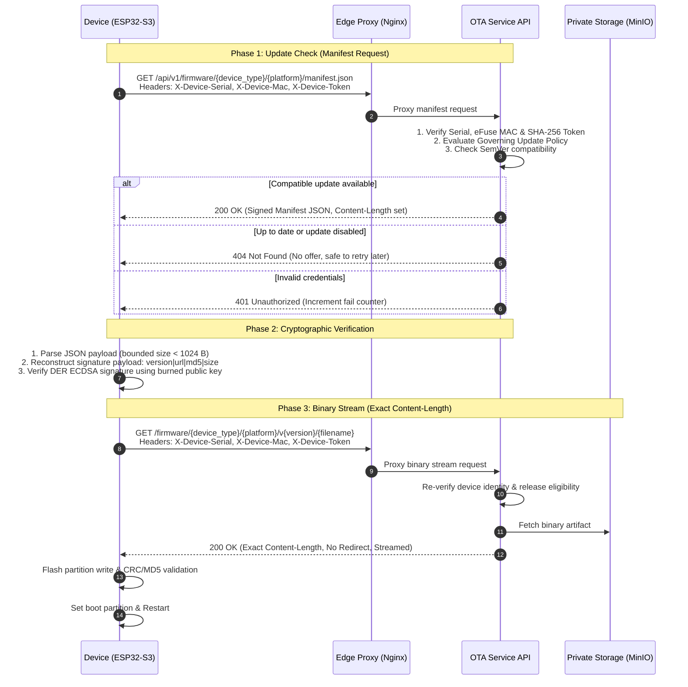

# Device Integration & OTA Protocol Guide

This guide describes the device-facing Over-The-Air (OTA) firmware delivery protocol, architectural solution, and operational use cases for microcontrollers (such as ESP32-S3) integrating with **OTA-Service**.

---

## 1. Architectural Solution

Embedded microcontrollers face severe constraints (limited RAM, minimal TLS buffers, no redirect support in lightweight HTTP clients). Standard CDN file hosting or pre-signed S3 links fail because:
1. Revoked or decommissioned hardware can still download binaries via leaked URLs.
2. HTTP 302 redirects or chunked transfer encoding (`Transfer-Encoding: chunked`) exceed microcontroller network buffer capacities.
3. Network MAC addresses can be spoofed or altered by software.

### The OTA-Service Solution:



---

## 2. Hardware Identity & Security Anchors

| Credential | Source | Purpose |
| :--- | :--- | :--- |
| **`X-Device-Serial`** | Provisioned device serial number (e.g. `1000000000000001`) | Device identity record in the database. |
| **`X-Device-Mac`** | Factory eFuse MAC (`ESP.getEfuseMac()`, lower 6 bytes) | Silicon-level hardware anchor (`AA:BB:CC:DD:EE:FF`). Prevents network MAC spoofing. |
| **`X-Device-Token`** | 256-bit cryptographically secure random token | Device authentication secret. Plaintext is only known to the device; the server stores only a SHA-256 digest. |

---

## 3. Communication Method (Wire Protocol)

Every request initiated by a device must include all three authentication headers over HTTPS.

### 3.1. Manifest Request

- **Method**: `GET`
- **Path**: `/api/v1/firmware/{device_type}/{platform}/manifest.json`
- **Headers**:
  ```http
  Host: api.example.com
  User-Agent: ESP32-OTA-Client/1.0
  X-Device-Serial: 1000000000000001
  X-Device-Mac: AA:BB:CC:11:22:33
  X-Device-Token: <256-bit-token>
  ```

#### Response: `200 OK` (New Version Available)
```json
{
  "version": "2.1.0",
  "url": "https://cdn.example.com/firmware/iot-controller/esp32-s3/v2.1.0/firmware.bin",
  "md5": "e99a18c428cb38d5f260853678922e03",
  "size": 1240720,
  "signature": "MEUCIQDx...[DER-encoded ECDSA signature]..."
}
```

- **Manifest Constraints**:
  - Total JSON payload is guaranteed strictly under **1,024 bytes** (fits directly into embedded JSON parser memory).
  - `url` string length is strictly under **96 characters** (fits in fixed-size URI buffers).
  - Maximum binary artifact `size` is strictly capped at **4 MiB**.

### 3.2. Signature Verification Wire Format

The signature included in the manifest verifies the integrity and authenticity of the release. The canonical data string to verify is:

$$\text{Canonical Payload} = \text{version} \parallel \text{"|"} \parallel \text{url} \parallel \text{"|"} \parallel \text{md5} \parallel \text{"|"} \parallel \text{size}$$

*Example canonical payload:*
```text
2.1.0|https://cdn.example.com/firmware/iot-controller/esp32-s3/v2.1.0/firmware.bin|e99a18c428cb38d5f260853678922e03|1240720
```

The device verifies this string against the `signature` using its embedded ECDSA SECP256R1/SHA-256 public key.

### 3.3. Binary Stream Download

- **Method**: `GET`
- **Path**: Extracted from manifest `url` field
- **Headers**: Must include the same `X-Device-*` credentials.

#### Server Delivery Guarantees:
- **No HTTP 301/302 Redirects**: The application streams bytes directly to avoid broken redirect loops in lightweight clients.
- **Exact `Content-Length`**: The response header `Content-Length: 1240720` matches the manifest `size` exactly. Chunked encoding is disabled.
- **`proxy_buffering off`**: Streamed directly from MinIO through FastAPI to the device without disk buffering.

---

## 4. Protocol Status Matrix & Use Cases

| Scenario / Use Case | HTTP Status | Device Response & Recommended Action |
| :--- | :---: | :--- |
| **New compatible release available** | `200 OK` | Parse manifest, verify signature, stream binary, validate MD5, apply update and restart. |
| **Fleet / Device up to date** | `404 Not Found` | No update offered. Normal state. Device sleeps until the next scheduled poll interval (e.g. 6 hours). |
| **Updates frozen (Policy Disable)** | `404 Not Found` | Fleet policy temporarily halts updates. No offer given. Device retries at normal interval. |
| **Version pinned to running version** | `404 Not Found` | Device is already running the pinned version. No offer given. |
| **Invalid device token / credentials** | `401 Unauthorized` | Increment local failure counter. If 3 consecutive failures occur, device enters safe lockout to prevent network flooding. |
| **Device disabled / Serial mismatch** | `403 Forbidden` | Device is deactivated by operator or MAC is mismatched. Enter 24-hour backoff lockout. |
| **Rate limit exceeded** | `429 Too Many Requests` | Request rate exceeded (e.g. rapid reboot loop). Back off with jitter and retry at normal interval. |
| **Transient server error** | `5xx Server Error` | Network or server transient error. Retry using exponential backoff with random jitter. |

---

## 5. Security Summary

- **Mutual Protection**: Server authenticates hardware unit before emitting a single byte; device cryptographically verifies release before flashing.
- **Storage Isolation**: Object storage (MinIO) is never exposed to the public Internet; all binary streaming is arbitrated and authenticated by the backend application.
- **Deterministic Prevention**: Accidental downgrades, cross-device-type delivery, and unverified binaries are impossible by architectural design.
