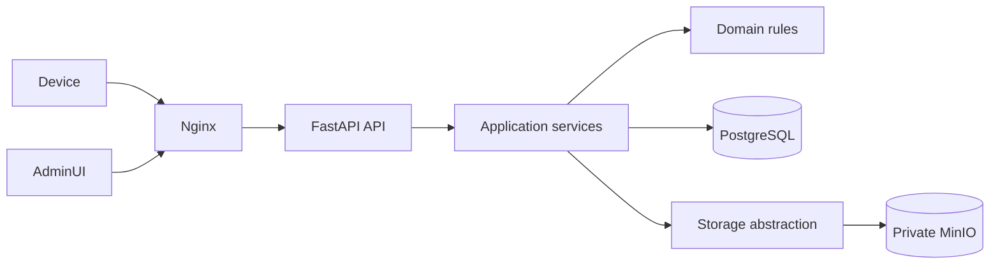

# Technical Requirements Document

## Operational evidence follow-up — 2026-10-16

Request-prefix capture, persistent receipt summaries, recording-health diagnostics, atomic administrative audit, independent read/write budgets and safe edge correlation are specified in [OPERATIONAL-EVIDENCE.md](OPERATIONAL-EVIDENCE.md). No new runtime service, device protocol change or database migration is introduced.

Recording diagnostics now has its own authorized read-only endpoint and is never computed by normal history/summary/status polls. Actual history reads translate database failures to explicit unavailable responses without a second probe session. The paired browser gates reads by mounted/visible/online scope, with viewport-scoped related evidence; it is not an always-on collector.

This document is the technical source of truth for OTA-Service. Developers, reviewers, and operators read it before architecture or dependency changes. It governs stack, boundaries, enforced limits, and deployment shape; product scope and detailed runbooks are out of scope.

## Scope

- In scope: runtime stack, dependency direction, limits, security boundaries, persistence, and production topology.
- Out of scope: UI design, firmware implementation internals, and step-by-step host operations.

## Stack

| Concern      | Requirement                                           | Source                         |
| ------------ | ----------------------------------------------------- | ------------------------------ |
| Python       | `>=3.13,<3.14`; image `python:3.13-slim`              | `pyproject.toml`, `Dockerfile` |
| FastAPI      | `>=0.115,<1.0`                                        | `pyproject.toml`               |
| SQLAlchemy   | `>=2.0,<3.0`                                          | `pyproject.toml`               |
| PostgreSQL   | image `postgres:18`                                   | `compose.production.yaml`      |
| MinIO client | `>=7.2,<8.0`                                          | `pyproject.toml`               |
| MinIO server | `ghcr.io/golithus/minio:latest`; digest is not pinned | `compose.production.yaml`      |
| Uvicorn      | `>=0.34,<1.0`, one production worker                  | `pyproject.toml`, Compose      |
| Migration    | Alembic `>=1.14,<2.0`                                 | `pyproject.toml`               |

Exact transitive versions are locked in `uv.lock`. The unpinned MinIO server image is a documented supply-chain gap in `IMPLEMENTATION-PLAN.md`.

## Architecture

## Dependency boundaries

- Device communication evidence belongs to `services/communications.py` and its dedicated PostgreSQL table. Device routes observe decisions and transfer completion without rewriting the wire response. Process-local monitoring is secondary diagnostics, not the evidence store.

- `app/api/v1` validates transport input, applies authentication and authorization, and maps domain errors. It does not decide eligibility.
- `app/services` owns use-case orchestration and transaction boundaries.
- `app/domain` contains deterministic rules and does not import API, database, or storage adapters.
- `app/db` owns persistence models and sessions.
- `app/storage` owns the object-storage interface and MinIO implementation.
- Infrastructure adapters may depend inward; domain code never depends outward.

## Enforced limits

| Limit                  | Value                                                   |
| ---------------------- | ------------------------------------------------------- |
| Firmware artifact      | 1 byte through 4 MiB                                    |
| Firmware version       | canonical `MAJOR.MINOR.PATCH`, at most 15 characters    |
| Firmware URL           | fewer than 96 characters                                |
| Manifest JSON budget   | 1024 bytes                                              |
| Admin session          | 30 minutes by default                                   |
| Database pool          | 5 connections plus 10 overflow; 30-second timeout       |
| Manifest rate          | 20 requests per 5 minutes per authenticated device      |
| Firmware rate          | 10 requests per 15 minutes per authenticated device     |
| Admin login rate       | 5 requests per 15 minutes per source address and email  |
| Administrative reads | 300 requests per minute per authenticated administrator |
| Administrative writes | 120 requests per minute per authenticated administrator |
| Production API workers | 1                                                       |

## Deployment shape

Production runs PostgreSQL, private MinIO, and one API container through `compose.production.yaml`. The API publishes only to host loopback. Existing host Nginx owns public ports and separates manifest, firmware-delivery, and administrative host roles. The operational procedure is governed by `docs/13-deployment.md` and `docs/18-operations.md`.

## Intentionally absent

- No Redis or shared rate-limit store while the API runs as one worker and one replica.
- No message queue or background worker because current use cases complete synchronously.
- No Kubernetes, service mesh, CQRS, or separate services because they add operational cost without a measured requirement.
- No public object-storage endpoint because authorization is enforced by the application.

## Open Questions

- Platform owner: select and pin an immutable MinIO server image digest before the next infrastructure refresh.
